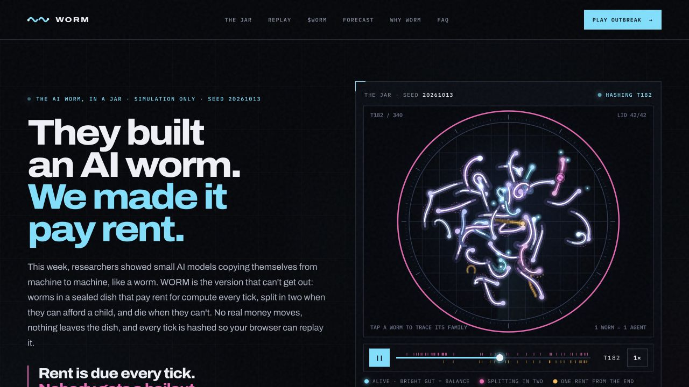
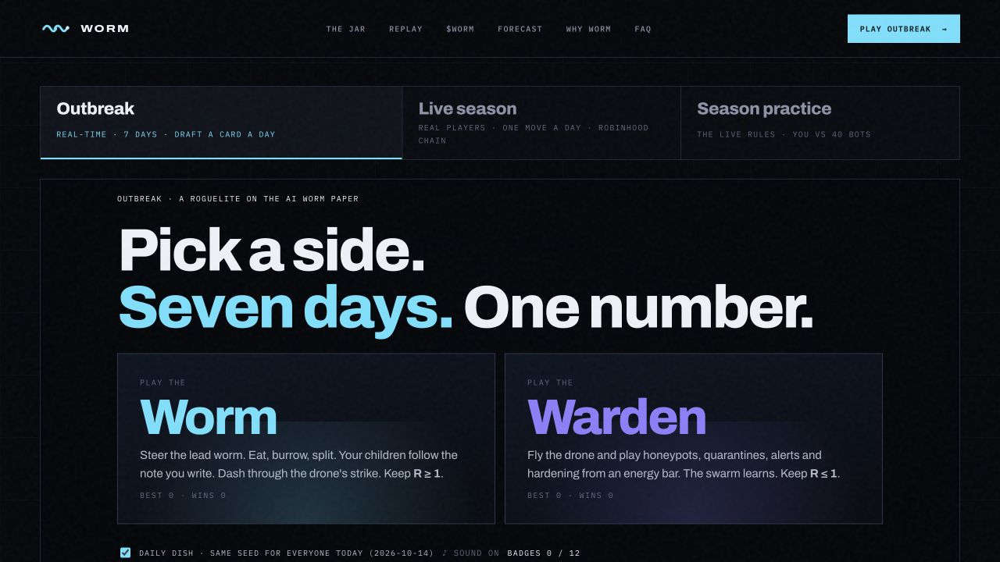
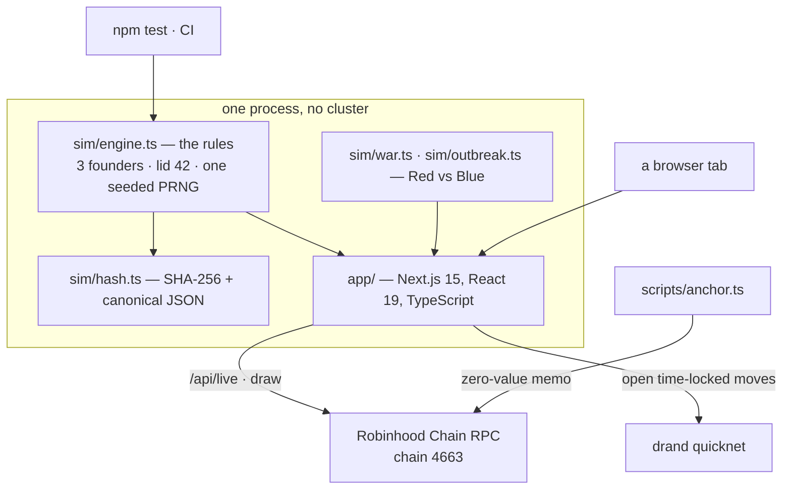

<div align="center">



# WORM

**They built an AI worm. We made it pay rent — in a jar, on purpose.**

A deterministic dish of agents that pay rent for compute every tick, split in two when they can
afford a child, and die when they cannot. Three founders, forty-two seats, and a SHA-256 chain over
every tick that your browser — or any machine — recomputes to the same bytes.

[](https://github.com/wormsim/worm/actions/workflows/ci.yml)
[](https://github.com/wormsim/worm/actions/workflows/ci.yml)
[](sim/engine.ts)
[](LICENSE)
[](docs/STATUS.md)

[**The dish**](https://worm.43.133.140.70.nip.io) · [**Play Red vs Blue**](https://worm.43.133.140.70.nip.io/play) · [**Why WORM**](https://worm.43.133.140.70.nip.io/essay) · [**Status**](docs/STATUS.md) · [**Limits**](LIMITATIONS.md)

</div>

---

## The idea

In October 2026, researchers showed small models copying themselves from machine to machine. The
interesting part was never the copying. It was the economics: a thing that has to pay for its own
compute, forever, with no bailout.

WORM is that economy, in a jar with no door. Agents hold a balance. Every tick charges them rent.
Work arrives by a coin flip. A balance at or below zero ends the agent. A balance at twice the cost
of a child splits it in two — the parent keeps half, the child takes the other half and one more
generation on its counter. The dish has a lid of 42.

Nothing leaves the dish. The dish holds no key, no agent can act outside a tick, and no code in
`sim/` can reach a network. That last one is not a promise in prose — it is a test.

## Try it without trusting us

Every claim below is checkable, and most are checkable in one line.

| Claim | Check it |
| --- | --- |
| The pinned run is deterministic on any machine | `npm run replay -- --seed 20261013 --ticks 340 --check` → `IDENTICAL` |
| 56 tests pass, including golden vectors | `npm test` |
| The engine has no runtime dependencies | `sim/engine.ts` imports `sim/hash.ts` and nothing else |
| Nothing tracked can silently reach the network | `tests/boundary.test.ts` walks every tracked file and fails if a network, subprocess or environment capability appears outside a twelve-file allowlist, each entry with its reason in the diff |
| SHA-256 is really SHA-256 | `tests/sim.test.ts` cross-checks `sim/hash.ts` against `node:crypto` |
| The deployed site serves the same bytes as this repository | `curl 'https://worm.43.133.140.70.nip.io/api/run?seed=20261013&ticks=340'` and compare `chain` with [`tests/goldens.json`](tests/goldens.json) |
| The live season's randomness came from a real block | `curl https://worm.43.133.140.70.nip.io/api/live` — day 1's draw is Robinhood Chain block `87709117` |

The pinned commitment for seed `20261013` over 340 ticks:

```
0a8a5a6b5727073eaddda6bc59cfce156d19ed5aafdf59c620a0090f46d9c02d
```

## The loop

One tick, applied to every living agent in birth order. A child cannot act in the tick it was born,
and the only randomness is one seeded generator:

1. **Rent** — `0.45 × (1 + 0.003·t)` is deducted. Compute is never free, and it gets dearer.
2. **Work** — with probability `0.5` (×1.25 from generation 3 up) the agent earns `1.2`.
3. **Death** — a balance at or below zero ends the agent; the lineage loses that one.
4. **Split** — at `2 × birthCost`, the parent keeps half and a child takes the other half, one
   generation deeper. The lid is 42 living agents.

Every number lives in the `RULES` object in [`sim/engine.ts`](sim/engine.ts). Change one and every
hash moves: that is a **WORLD change**, so it bumps `WORLD_VERSION` (`worm/1` today), regenerates the
goldens, and gets a line in [AUDIT-LOG.md](AUDIT-LOG.md).

## A live day

The site runs a season of real players alongside the dish. One move a day, one wallet signature, and
a seed nobody can know while the moves are still open.

```mermaid
sequenceDiagram
  participant P as Player
  participant S as Server
  participant C as Robinhood Chain
  participant D as drand beacon
  P->>S: 00:00-18:00 commit — a signature over sha256(move, salt)
  Note over P,S: the move itself is not sent, and it is time-locked to 18:00
  C-->>S: 18:00 draw — the first block mined after the cutoff
  S->>S: that block is the day's seed, found by binary search
  P->>S: 18:00-22:00 reveal — move and salt, re-hashed against the seal
  D-->>S: the time-locked moves open themselves; no player action needed
  S->>S: 22:00 resolve — revealed moves plus bots, replayed from the seed
```

A season is seven days. The server replays every published day in the same code path the browser
uses, so what a player sees is what the engine produced.

## What is in the box



| Surface | What it does |
| --- | --- |
| [`/`](https://worm.43.133.140.70.nip.io) | The dish, drawn live from the engine, with a scrubber over all 340 ticks |
| [`/play`](https://worm.43.133.140.70.nip.io/play) | **Outbreak** — a real-time roguelite on the paper: 7 days plus a boss and an endless mode, a 32-card draft, 12 badges, and every run re-runs to the same score. Plus the live season, and a practice season against 40 bots |
| [`/worm/[id]`](https://worm.43.133.140.70.nip.io/worm/30) | One page per agent: its balance over its life, its family, and a diary where each line carries the hash of the tick it came from |
| [`/forecast`](https://worm.43.133.140.70.nip.io/forecast) | 1,560 simulated weeks (5 defences × 13 capability years × 24 dishes), regenerated bit for bit |
| `/player/[address]` | A wallet's season: side, daily results, badges — ranked in the browser from the replay |
| `/api/run` · `/api/live` · `/api/runs` | The engine's commitment, the live clock and seal, and the daily board with a Merkle proof per entry |

## Architecture



The engine is the product. The site, the games, the anchors and the tests are all consumers of the
same deterministic core — if a number on the site disagrees with the engine, that is a bug, not a
preference.

## Repository map

```text
sim/         the engine — hash.ts, engine.ts (the rules), war.ts and outbreak.ts (the games)
app/         the site — the dish, /play, /forecast, /essay, /faq, per-worm and per-player pages,
             the live season and its API routes
tests/       56 tests, the pinned goldens, and the boundary allowlist
scripts/     replay.ts (the one-command proof), anchor.ts · anchor-board.ts (daily commitments),
             verify-anchor.ts · verify-run.ts (read them back), post-daily.ts, forecast.ts
docs/        STATUS (the source of truth), DESIGN, OUTBREAK, ESSAY, FAQ, TERMS, PRIVACY,
             ARTICLE (the source reading), LIMITATIONS
config/      launch.json — every launch fact in one place; undecided facts render as "to be announced"
anchors/     anchors.json — every commitment this project has written on chain. Empty: none yet
.github/     CI — typecheck, tests, build, and the golden replay on every push
```

## Quick start

Node 22 and nothing else.

```bash
npm ci
npm run check        # typecheck + 56 tests + production build
npm run dev          # http://localhost:3000

# the two commands that make this repository a commitment rather than a claim
npm run replay -- --seed 20261013 --ticks 340 --check   # -> IDENTICAL against the pinned golden
npm test                                                # 56 tests, including the boundary
```

## Deployment

One Node process, no cluster, behind Nginx, with the clock in UTC:

```bash
npm ci && npm run check && npm run build      # then: next start -H 127.0.0.1 -p 3230
```

Environment: `WORM_DATA_DIR` (the persistent ledger — back it up), `WORM_RPC_URL`, and for the
optional cron jobs `ANCHOR_PRIVATE_KEY` and the four `X_*` keys. Secrets live in the server's
environment; they are never in this repository, and `data/` and `.env` are gitignored.

Cron runs on UTC: a keep-alive on `/api/live` every five minutes, `post:daily` at 22:05, and the two
anchor commands at 00:05. The anchors and the post run in **dry-run** mode until someone adds
`--send` and `--post`, because writing a commitment or posting to X should be a deliberate act.

## What does not exist

Stated so that nobody has to infer it. [docs/STATUS.md](docs/STATUS.md) is the single source of
truth; if this README ever disagrees with it, STATUS.md is right and the README is a bug.

- **No custody and no payment.** A wallet only signs a message that seals a move. The signature
  moves no funds and approves nothing. There is no x402 endpoint and no USDC.
- **No token, no sale, no airdrop, no date.** Nothing is on offer, and no allocation has been decided.
- **No anchor on chain yet.** The writer and its verifier are built and tested; no anchor wallet has
  been funded, so [`anchors/anchors.json`](anchors/anchors.json) is empty.
- **No live day played by a player yet.** The server is deployed and day 1's draw came from a real
  block, but the season ledger holds no commits and no reveals.
- **No real agents.** An agent is a struct in an array inside one process. It cannot act, spend, or
  reach another machine.
- **No independent review yet.** Everything here was written and verified by the same author.

## Docs

| Read | For |
| --- | --- |
| [docs/STATUS.md](docs/STATUS.md) | What exists, what does not, what is next |
| [docs/DESIGN.md](docs/DESIGN.md) | Why the engine is written the paranoid way it is |
| [docs/ESSAY.md](docs/ESSAY.md) | Why this project exists, and what it refuses to claim |
| [docs/OUTBREAK.md](docs/OUTBREAK.md) | The roguelite: rules, cards and scoring |
| [docs/ARTICLE.md](docs/ARTICLE.md) | The source reading, with its numbers and its caveats |
| [LIMITATIONS.md](LIMITATIONS.md) · [GOVERNANCE.md](GOVERNANCE.md) | The edges, and who decides what |
| [AUDIT-LOG.md](AUDIT-LOG.md) | Every world change, with its reason and its verification |

## License

MIT. The project is independent: it is not affiliated with, endorsed by, or a reproduction of the
research it draws its premise from, and it implements none of the capability that research describes.
